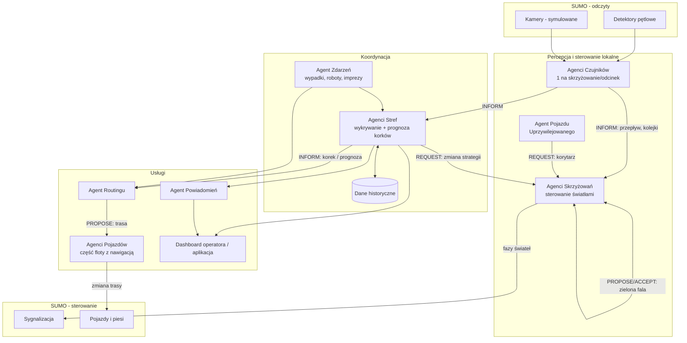

# Inteligentny ruch uliczny i ostrzeżenia o korkach – Tarnów

**Projekt:** `multi-agent-traffic-control`

## 1. Cel

System wieloagentowy, który monitoruje ruch pojazdów i pieszych w symulowanym fragmencie Tarnowa. System:
- wykrywa i **prognozuje** korki,
- adaptacyjnie steruje sygnalizacją,
- proponuje trasy alternatywne kierowcom i pieszym,
- wysyła ostrzeżenia.

Projekt ma dwie fazy:

| Faza | Podejście | Rdzeń decyzyjny |
|---|---|---|
| 1 (pół semestru) | Klasyczny system wieloagentowy | Reguły, algorytmy, negocjacje agentów |
| 2 (pół semestru) | Agenci z LLM | LLM + narzędzia (tool calling) obok/zamiast reguł |

Obie fazy uruchamiamy na **tych samych scenariuszach**, więc wyniki można porównać.

## 2. Środowisko i technologie

- **Symulacja ruchu:** SUMO (Simulation of Urban MObility) + TraCI (sterowanie z Pythona)
- **Mapa:** Tarnów z OpenStreetMap (import przez `osmWebWizard.py`). Dwie strefy:
  - **Centrum** – oś ul. Krakowska – ul. Lwowska,
  - **Mościce** – ul. Kwiatkowskiego (Grupa Azoty, dojazd do węzła A4), ul. Czerwonych Klonów, ul. Traugutta, ul. Zbylitowska (stadion).

  Później możliwe rozszerzenie na całe miasto.
- **Agenci (faza 1):** Python + SPADE (komunikacja w stylu FIPA-ACL)
- **LLM (faza 2):** API modelu lub model lokalny (Ollama) z tool calling
- **Dashboard:** prosta aplikacja webowa (mapa ciepła, ostrzeżenia, KPI)

## 3. Architektura

### Agenci

| Agent | Odpowiedzialność | Algorytm (faza 1) |
|---|---|---|
| **Czujnika** | Agreguje dane z detektorów/kamer i filtruje szum | Okno przesuwne, średnie |
| **Skrzyżowania** | Dobiera fazy i czasy świateł, koordynuje się z sąsiadami, daje priorytet opóźnionym autobusom MPK | Max-pressure + negocjacje (zielona fala) |
| **Strefy** | Wykrywa korki w obszarze i prognozuje je na 10–15 min | Progi (prędkość < 40% swobodnej, zajętość), regresja / proste ML na szeregach czasowych |
| **Routingu** | Wyznacza trasy alternatywne i rozkłada ruch | Dijkstra/A* z dynamicznymi wagami + losowe rozłożenie (unikanie „efektu stada”) |
| **Pojazdu** | Reprezentuje kierowcę z nawigacją i decyduje, czy przyjąć trasę | Funkcja użyteczności (czas, liczba zmian) |
| **Zdarzeń** | Wprowadza wypadki, roboty drogowe i imprezy masowe | Harmonogram + losowe incydenty |
| **Pojazdu uprzywilejowanego** | Prosi o korytarz dla karetki | Contract Net ze skrzyżowaniami na trasie |
| **Powiadomień** | Formułuje ostrzeżenia i wybiera kanał | Szablony + priorytety |

### Poziomy zatłoczenia

| Poziom | Stan | Warunek (przykładowy) |
|---|---|---|
| 0 | Ruch płynny | prędkość ≥ 70% swobodnej |
| 1 | Utrudnienia | prędkość 40–70% swobodnej |
| 2 | Korek | prędkość < 40% swobodnej lub kolejka nie znika w jednym cyklu świateł |
| 3 | Zator / incydent | prędkość < 15% swobodnej lub zgłoszone zdarzenie |

### Zmiany w fazie 2 (LLM)

- **Agent Koordynator (LLM)** dostaje stan miasta jako narzędzia (`get_congestion`, `set_signal_plan`, `reroute_area`, ...) i planuje działania przy sytuacjach nietypowych, np. wypadek w czasie meczu.
- **Agent Zdarzeń (LLM)** zamienia tekstowe zgłoszenia (od użytkowników, komunikaty służb) na ustrukturyzowane zdarzenia: miejsce, typ, szacowany czas trwania.
- **Agent Powiadomień (LLM)** generuje ostrzeżenia w języku naturalnym, dopasowane do odbiorcy (kierowca, pieszy, operator).
- **Asystent (czat)** odpowiada na pytania, np. „Jak najszybciej dojechać na dworzec PKP o 17:00?” albo „Dlaczego na Krakowskiej jest korek?”.
- Agenci niskopoziomowi (Czujniki, Skrzyżowania) zostają klasyczni, bo wymagają szybkich i deterministycznych decyzji.
- **Bezpieczeństwo:** LLM nie steruje światłami bezpośrednio. Proponuje plan, a Agent Skrzyżowania go waliduje (minimalny czas zielonego, maksymalna długość cyklu, brak faz kolizyjnych).

## 4. Dane wejściowe

| Źródło | Dane | Częstotliwość |
|---|---|---|
| Detektory pętlowe (SUMO) | Liczba pojazdów, prędkość średnia, zajętość pasa | co 1–5 s |
| Kamery (symulowane z SUMO) | Długość kolejki, liczba pieszych na przejściu | co 5 s |
| GPS pojazdów (floating car data) | Pozycja, prędkość części floty | co 1–5 s |
| Sygnalizacja | Aktualna faza, czas do zmiany | ciągle |
| Sieć drogowa (OSM) | Graf ulic, pasy, limity prędkości | statycznie |
| Zdarzenia | Wypadki, zamknięcia pasów, roboty drogowe | zdarzeniowo |
| Rozkład jazdy MPK | Kursy autobusów, opóźnienia względem rozkładu | statycznie + ciągle |
| Kalendarz imprez i zmian | Mecze, koncerty, koniec zmian w Grupie Azoty (miejsce, godzina, skala) | z wyprzedzeniem |
| Dane historyczne | Profile ruchu wg godziny/dnia tygodnia | do prognoz |
| *Faza 2:* tekst | Zgłoszenia użytkowników, komunikaty, pytania | zdarzeniowo |

### Skąd bierzemy dane

Wyłącznie dane publicznie dostępne.

| Źródło | Co dostarcza | Rola w projekcie |
|---|---|---|
| **Symulacja SUMO** | Wszystkie odczyty „czujników” w czasie rzeczywistym | Główne źródło danych dla agentów |
| **Strategiczna mapa hałasu Tarnowa 2022** (tarnow.pl) | Natężenie ruchu na głównych ulicach (dane wejściowe do modelu hałasu) | Kalibracja popytu wewnątrz miasta |
| **Rozkłady MPK** (komunikacja.tarnow.pl) | Linie i kursy autobusów | Autobusy w symulacji, priorytet dla komunikacji miejskiej |
| **GDDKiA, GPR 2025** | Natężenie ruchu na drogach wokół miasta (A4, drogi krajowe) | Ile pojazdów wjeżdża do miasta. Pomiar nie obejmuje odcinków wewnątrz miasta |
| **Własne pomiary** | Nagranie 1–2 skrzyżowań w szczycie, zliczanie modelem YOLO | Walidacja natężeń i długości kolejek |
| **TomTom / HERE Traffic API** | Prędkości i czasy przejazdu na żywo | Walidacja czasów przejazdu |
| **IMGW (API publiczne)** | Pogoda | Dodatkowa cecha w prognozie korków |
| **Kalendarze wydarzeń** | Mecze żużlowe Unii Tarnów, imprezy, zmiany pracy w Grupie Azoty | Zdarzenia zaplanowane |
| *Faza 2:* teksty generowane / lokalne newsy | Zgłoszenia i komunikaty o utrudnieniach | Wejście dla agenta zdarzeń LLM |

## 5. Dane wyjściowe

| Wyjście | Odbiorca | Postać |
|---|---|---|
| Plany sygnalizacji (fazy, czasy, offsety) | Sygnalizatory (SUMO) | Polecenia TraCI |
| Ostrzeżenia o korkach | Kierowcy, tablice VMS, aplikacja | Lokalizacja, poziom (0–3), przewidywany czas trwania, objazd |
| Trasy alternatywne | Pojazdy z nawigacją, piesi | Lista odcinków + szacowany czas |
| Korytarz dla pojazdu uprzywilejowanego | Skrzyżowania na trasie | Sekwencja przełączeń świateł |
| Mapa ruchu | Operator | Dashboard: mapa ciepła, prognoza |
| Raport / KPI | Operator, porównanie faz | Czasy przejazdu, kolejki, CO2 |
| Log komunikacji agentów | Analiza, debugowanie | Plik zdarzeń |
| *Faza 2:* komunikaty w języku naturalnym | Wszyscy | Tekst, odpowiedzi czatu, uzasadnienia decyzji |

## 6. Co jest proaktywne

**Proaktywność** oznacza, że agent działa z własnej inicjatywy, żeby osiągnąć cel. Nie czeka na żądanie ani na wystąpienie problemu.

| Zachowanie proaktywne | Agent | Dla porównania: zachowanie reaktywne |
|---|---|---|
| **Prognozuje korek** na 10–15 min naprzód i reaguje, zanim on powstanie | Strefy | Reakcja dopiero na istniejący korek |
| Sam **inicjuje negocjacje** z sąsiednimi skrzyżowaniami (zielona fala), gdy widzi rosnący napływ | Skrzyżowania | Lokalna zmiana świateł po wykryciu kolejki |
| **Wysyła (push) trasy** pojazdom zbliżającym się do zagrożonej strefy, bez pytania o nie | Routingu | Trasa wyliczana na zapytanie kierowcy |
| **Rozkłada ruch** na kilka objazdów, żeby nie przenieść korka gdzie indziej | Routingu | Wszyscy dostają tę samą najkrótszą trasę |
| **Przygotowuje plan specjalny** przed imprezą (mecz, koncert) lub końcem zmiany w Azotach | Strefy + Zdarzeń | Działanie dopiero po napływie pojazdów |
| **Przełącza światła z wyprzedzeniem** na trasie karetki | Skrzyżowania | Karetka czeka na zielone |
| **Ocenia własne decyzje** i wycofuje zmianę, która nie pomogła | Wszyscy decyzyjni | Brak sprzężenia zwrotnego |
| *Faza 2:* sam wykrywa nietypowe sytuacje i proponuje operatorowi działania z uzasadnieniem | Koordynator LLM | Operator pyta system |

## 7. Scenariusze testowe i metryki

**Scenariusze:**
1. Poranny szczyt (wjazd do centrum ul. Krakowską i Lwowską)
2. Koniec zmiany w Grupie Azoty: przewidywalny szczyt na ul. Kwiatkowskiego i Czerwonych Klonów, test proaktywnego planu świateł
3. Wypadek na A4: ruch tranzytowy zjeżdża do miasta
4. Mecz żużlowy na stadionie w Mościcach (ul. Zbylitowska): nagły napływ i odpływ pojazdów oraz pieszych
5. Przejazd karetki w szczycie

**Punkty odniesienia (baseline):**
- stałe czasy świateł, brak reroutingu,
- sygnalizacja akomodacyjna (tryb `actuated` w SUMO). Ten wariant jest bliższy rzeczywistości, bo sygnalizacja w Tarnowie nie pracuje w trybie stałoczasowym.

**Metryki (KPI):**
- średni czas przejazdu i czas oczekiwania
- długość kolejek, liczba zatrzymań
- emisja CO2 (liczona przez SUMO)
- czas przejazdu karetki
- opóźnienia autobusów MPK
- trafność prognozy korków (MAE) i wyprzedzenie ostrzeżenia
- *faza 2:* jakość komunikatów (ocena ręczna), czas odpowiedzi i koszt LLM

**Wynik końcowy:** porównanie baseline, fazy 1 (MAS) i fazy 2 (LLM) na każdym scenariuszu.

## 8. Podział pracy (wstępny)

| Osoba | Faza 1 | Faza 2 |
|---|---|---|
| 1 | Środowisko SUMO, mapa Tarnowa (import i poprawki), scenariusze, metryki | Narzędzia (API) dla LLM |
| 2 | Agenci Czujników + Skrzyżowań (max-pressure, zielona fala, korytarz) | Koordynator LLM |
| 3 | Agent Strefy (wykrywanie + prognoza) | Agent Zdarzeń LLM (parsowanie tekstu) |
| 4 | Agent Routingu, Pojazdów, Powiadomień + dashboard | Powiadomienia LLM + asystent czatu |
